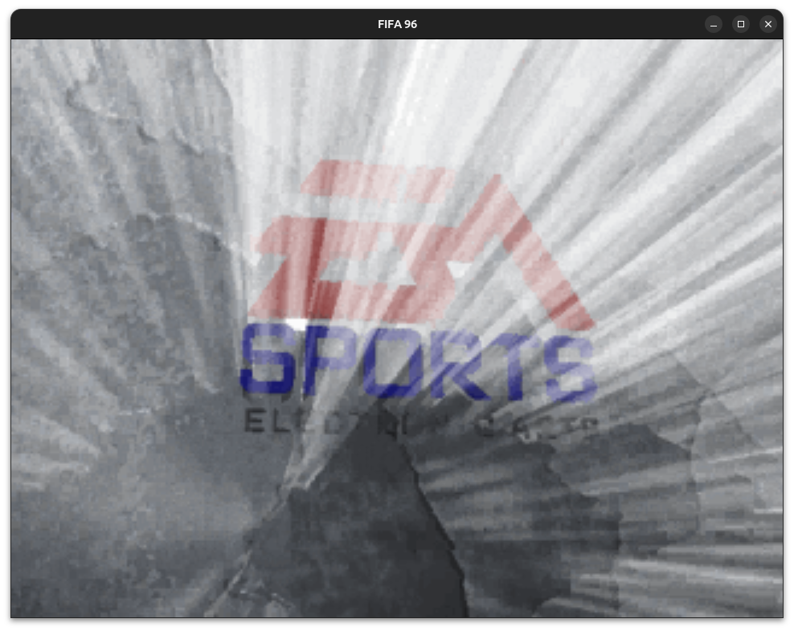

# FIFA 96 (DOS, 1995) — Reverse Engineering (100%)



Reverse engineering of the **FIFA 96** PC/DOS CD-ROM release: the 16-bit
`FIFA96.EXE` loader/dispatcher, the protected-mode game image appended to the
same file (where the codecs and audio live), and the game's data formats
(`.QFS`, `.POG`, `.TGV`/kVGT/fVGT, `.PVI`/VIV/BIGF, `.BNK`/`.CRD`, EACS
audio). The work proceeds in evidence-gated slices: every address, byte and
claim in [`port/spec/loader_rename_map.md`](port/spec/loader_rename_map.md)
and the `port/spec/FU*.md` derivations is backed by a cited disassembly
output or a reconciled raw-byte read; anything not statically provable is
recorded as a named open leg, never asserted.

The loader is a **16-bit real-mode executable** (`x86:LE:16:Real Mode`, entry
`11bd:2382`) whose code lives in three segments (`1000`, `11bd`, `1991`). It
stages segment selectors, installs mode-vector handlers, flips CPU state via
`SMSW`/`LMSW`, and temporarily patches interrupt vectors at runtime — so a
large part of the story is self-modifying and vector-driven, and the map is
the record of what static analysis can and cannot attribute. The game proper
is a 32-bit LE image appended to the same file (FU-4): the codec and audio
slices work against that flat image, using the measured load delta `0x1FC000`
and the dump delta located by `fifa96_runtime.find_delta`.

## Game assets

The original game files are **not included** in this repository. Place the CD
image at `data/game/FIFAPCCD96.iso` (git-ignored, read-only by convention — no tool
or test ever writes to it); `data/game/hdd/` is likewise ignored and is emulated
disk state. The capture rig, `tools/run-fifa96.sh` and the rig tests need the ISO;
the port's golden fixtures — captured byte excerpts committed under
`port/tests/golden/` — let the container/codec/audio tests run without it.

## Layout

| Path | What |
|---|---|
| `port/spec/loader_rename_map.md` | Real-mode loader evidence map: 30 dated sections, every claim byte-cited — the single source of truth for the loader spine (336 functions analysed) |
| `port/spec/FU*.md` | Per-slice derivations from the protected-mode LE image: codec maps (FU-19/22/24/25/28/33), containers (FU-29..32), EACS/audio/music (FU-35..53), presentation (FU-55..57), match logic (FU-58..75) |
| `port/spec/FU1_FU2_closeout.md`, `FU2_*`, `FU3_*` | Early closeouts: wrapper citations, the capture-resolved filename↔container binding, and the open CRC-over-transformed-content question |
| `docs/superpowers/plans/`, `docs/superpowers/specs/` | One implementation plan/spec per slice (the process record) |
| `docs/PROGRESS.md` | The current progress narrative (moved out of the README): evidence-map coverage, port chains, engine/M2 acceptance state, carried legs |
| `port/src/fifa96_loader/` | The C port (~40 libraries): INT-21 wrappers, envelope, QFS, POG, TGV, VIV, ISO9660 reader, load-order tables, script, trace; codec chain refpack/huff/tree/record/kVGT/TGV-stream/fVGT/EACS; audio BIGF/BNK/SFX/voice/mixer/settings/pacing/music/CRD; presentation player/blit/VGA; match layer tick/input/match-pace/state/lifecycle/event-queue/display/control/camera/ball/keeper/outfield/entity/ring/stats/frontend/competition/settings-handoff |
| `port/src/fifa96_engine/` | The native engine layer (platform ABI, SDL3/null backends, boot/intro/front-end/match drivers, M1/M2 acceptance tapes) — see [`port/ENGINE.md`](port/ENGINE.md) |
| `port/tests/`, `port/tests/golden/` | CTest suite (124 tests) over captured container/codec/audio/video bytes (`golden/vgt/`, `golden/eacs/`, `golden/audio/`) plus the engine goldens (`golden/engine/`) |
| `port/tools/fifa96_play.c` | Host runner used by `make run FILE=…` / `make run ARGS=…` ([port/HOST_RUNNER.md](port/HOST_RUNNER.md)): explicit `video`/`audio`/`sprite` modes plus `auto` (bare `FILE`) — TGV chunk stream → PPM/Mode-X, EACS/BNK/VIV → WAV, BIGF `.pvi` sprite → PPM, and an ISO9660 walk + bounded smoke pass |
| `port/tools/fifa96_dump.c` | Standalone container dumper (debug aid) — `0xFB10` envelope, QFS, POG, `kVGT` TGV, VIV offset tables via the shared `port/tools/fifa96_detect.c` sniff |
| `tools/*.py`, `tools/keys/` | Runtime capture rig: LE-image rebuild (`fifa96_le.py`), ISO patch/probe (`fifa96_patch.py`, `fifa96_probe.py`), trace map/bind (`fifa96_runtime.py`, `fifa96_bind.py`), VGT/fVGT extraction, key-step driver, frame export |
| `_tools/tsr/fifa96_capture.asm` | 16-bit `.COM` capture TSR emitting framed FILE/CODEC/PROBE records over COM1 (`make tsr`) |
| `tools/run-fifa96.sh`, `tools/run-fifa96-capture.sh` | Original game under DOSBox-X; capture-run driver (`make capture` / `make trace`) |
| `data/fifa96.gpr`, `data/fifa96.rep/` | The Ghidra project (MZ loader plus flat LE image); analysis lives with the docs |
| `port/CMakeLists.txt`, `Makefile` | `make help` — `configure`/`build`/`test`/`check`/`run`/`game`/`tsr`/`capture`/`trace`/`clean`/`rebuild` |

## Toolchain

* **Ghidra**: the MZ loader is analysed as `x86:LE:16:Real Mode`; the
  codec/audio slices analyse the flat LE image rebuilt from the same file by
  `tools/fifa96_le.py` (FU-4).
* **C11 + CMake ≥ 3.28 + CTest**, compiled `-Wall -Wextra -Werror`.
* **Python 3** for the capture rig and its CTest cases; **nasm** for the TSR.
* **dosbox-x** for ground truth (runtime behaviour, memory layout).

## Status

The progress narrative (evidence-map coverage, port chains, engine/M2 state
and carried legs) lives in **[docs/PROGRESS.md](docs/PROGRESS.md)**; the title
percentage above is derived from the `port/ENGINE.md` **port-coverage** census:
all **78 native dispatch bodies** (80 slots minus the phase-`0x16` INT3
sentinel and the action-`0x2B` shared epilogue) now have a C implementation,
so `floor(100 × 78 / 78) = 100`. The stricter runtime metric is reported
separately: **61/80 dispatch slots naturally wired (64/80 install-live)**,
with the three producer-blocked rows named in the phase-36/38 registers
(`port/ENGINE.md`, FU-338 §4, and the row-`0x25` errata below).

## Build and run

```bash
make check                     # sanitized gate: configure + strict build + full CTest suite (124 tests)
make run                       # playable Release engine on data/game/FIFAPCCD96.iso (no extra args)
make game                      # build/run the playable Release engine (build-release/)
make run FILE=data/game/FIFAPCCD96.iso    # host runner: sniff the ISO, bounded decode pass under build/run/
make run FILE=port/tests/golden/fw1.qfs   # any container: envelope/QFS/POG/TGV/VIV auto-detect + decode
make run ARGS="--help"         # host runner modes; ARGS="video FILE --out build/play" etc.
make tsr                       # assemble build/FIFAPCCD.COM (capture TSR, needs nasm)
make capture                   # run the game under the rig via tools/run-fifa96-capture.sh (needs the ISO)
make trace TRACE=data/captures/session-*/trace.bin   # parse a capture
./tools/run-fifa96.sh                # the original game under DOSBox-X (needs data/game/FIFAPCCD96.iso)
```

## Play

The windowed SDL3 build is the playable game:

```bash
make game                     # or: make run
```

`make game` builds a **Release** executable in `build-release/`; the
`make check` gate keeps its ASan/UBSan build so the per-pixel pitch caster
runs at play speed in the game and stays instrumented in the tests. The live
kickoff puts the selected taker on the ball (the skipped cutscene placement),
so **Z** releases the opening kick immediately.

It boots the intro (any key skips it) into the native **Game Select** screen.
Move with the arrows and press **Enter** to choose. **Friendly** opens the
two-team selector: the arrows change the highlighted Home/Visitor entry,
**Enter** starts the match, **X**/Backspace backs out. **Options** opens the
native settings list: arrows change the value, **Enter** cycles it, and
**X**/Backspace backs out. Half Length, SFX Volume and Sound Effects are live;
the Fouls, Injuries and Offside rows are stored and handed to the match, while
live contact-foul and offside proof remain a leg (the options are not silent
no-ops: the match config receives them). All nine Game Select entries are
live: **Leagues**, **Tournaments** and **Playoffs** open a derived eight-team
competition (pick the home team, then Play/Simulate each fixture, view the
table/bracket, save or load); a drawn cup tie opens a player-facing five-round
penalty shootout. **Practise** starts a no-stakes session; **Load Game**
restores one of ten derived slots; **Modem Setup** shows the honest offline
notice (native modem transport remains a leg). The competition fixtures,
tables, shootout and save records are derived from the native mode bytes and
are labelled as such; the native league/tournament screen art and data layouts
remain open legs. The shell composes the real 640x480 MOD2/MOD1 art, the SLICK
title/menu fonts and the animated VS mark; the match uses a derived class-3
side-camera follow view, a derived stadium stand/end wall built from the native
stand/crowd banks, the native `Net.fsh` goal mesh, mowing stripes, player
shadows, a live off-ball team shape with one forward support run, live record
facing staged from the native `+0x7D` word, and a uniform 2x 640 HUD. The
windowed build renders at the native 640x480 surface in a 1280x960 window;
the headless tape path stays 320x240.

Match controls: **arrows** move the controlled player, **Z** kicks,
**C** passes, **V** plays a long ball, **Q** switches to the next outfield
player, **T** makes a deliberate contact challenge; **Esc** pauses
(**Enter** resumes, **X** quits to the menu). When the human wins a free kick
or penalty, **Left/Right** aim across the goal mouth, **Up/Down** change power
and **Z**/**Enter** confirms; a bounded window auto-delivers the shot if no key
arrives. While paused, **S** opens the derived substitution
menu: arrows choose OUT, **Enter** opens the IN list, arrows choose the
replacement, **Enter** applies it, and **X** backs out one level. It enforces
GK-for-GK, hides used bench players and caps at three per side (the native
selection FSM/timing remains a leg). The CPU opponent now passes/shoots after a
short possession hold, can win
a stationary ball with a contact tackle, and the keeper distributes after a
save (all derived, live-only). At half-time the panel shows for three seconds
and then the native kickoff gate starts the second half automatically;
**C**/pass (or **Z**) starts it immediately. Halves are 2 minutes (120
seconds) by default and configurable in **Options** (2/4/6/8/10/20/45-minute
halves). The HUD shows the team codes, score, period and clock; at full time
the result panel holds for five seconds, then returns to the competition hub
for a League/Tournament/Playoff match or Game Select for Friendly/Practise
(or press **Enter**). Competition progress auto-saves slot 0 after each
result; the **Load Game** screen lists ten `F96SAVE%.2d.DAT` slots under
`data/game/hdd/` (the distinct port format never overwrites native `SGAME`
files). Crowd ambience and the whistle play through SDL3 audio when the ISO is
mounted; their gain follows the SFX Volume and Sound Effects options.

Gamepad: D-pad moves; **A/South** kicks in play and selects in menus;
**B/East** passes in play and backs out in menus; **West** plays the long
ball; **North** opens the pause substitution menu; **LB** switches the
controlled outfield player; **RB** makes a contact challenge. D-pad moves the
list and **A/South** selects; **B/East** backs out one level. Keyboard
**Enter**/**Backspace** share those confirm/back roles and therefore also
kick/pass in active play.

At the kickoff a **Z** press/release shoots through the native
live-control/kick/goal path (the same kick releases the opening possession
latch). Hold **Up** or **Down** with **Z** to aim the shot at ±0x80 along the
goal-mouth width (the native movement axis: Up = +x, Down = -x); Left/Right
move along the goal-side axis and are not shot aims. An unaimed (or
both-Up/Down) shot goes to the centre, where the defending keeper usually
saves it if it is in position; a displaced keeper can let it through.
After a goal, arrows take the nearest defender to the ball for a contact
tackle/claim, and **Z** kicks again with the score preserved. A live defender
can also block a shot. When the human side is awarded a free kick or penalty,
the installed taker is bound to the live controls: **Left/Right** moves the
derived goal-mouth aim, **Up/Down** changes the power band, and **Z**/**Enter**
launches the shot; **A/South** does the same on a pad. The native taker row is
held at its kick stage for this window and the same derived shot is delivered
automatically if the window expires; an opponent's taker keeps the native auto
row. The aim, power, confirm and launch are labelled live stand-ins for the
unported native `0x4C114/18/1C` input words and slot `word[+6]` hand-off; the
keeper save and defender block remain the same live stand-ins as open play,
not native AI.

## Conventions

* Address renders: the loader map quotes `11bd:`-segment addresses; gap rows
  print in `1000:` space with the fixed delta `−0x1BD0` between views. The
  LE-image derivations use flat image addresses; runtime mapping uses the
  measured load delta `0x1FC000`, with the dump delta from
  `fifa96_runtime.find_delta`.
* Raw-byte quotes must reconcile the tool's hex and data renderings before
  being printed verbatim.
* "Not attributable from enumerated sweeps (defined-instruction scope, at
  slice time)" is the correct negative; "does not exist" is never claimed
  for dynamic or runtime-written state.

## License

MIT — see [LICENSE](LICENSE). This repository hosts analysis and a clean-room
data/codec/audio port; it contains no original game code or assets.
